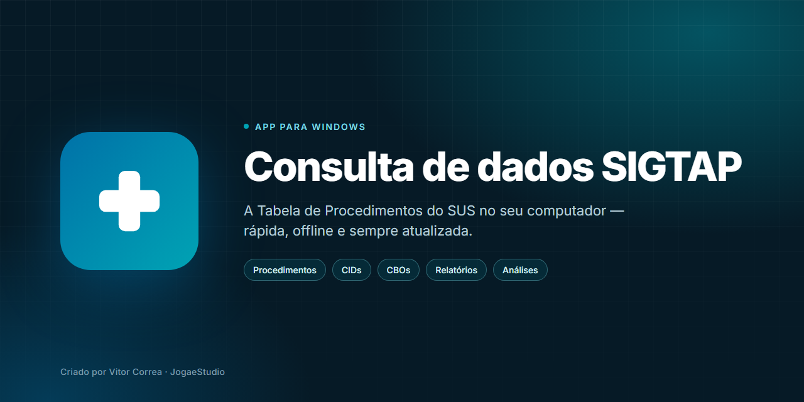

<picture>
  <source media="(prefers-color-scheme: dark)" srcset="assets/capa-escura.png">
  <source media="(prefers-color-scheme: light)" srcset="assets/capa-clara.png">
  
</picture>

  

**A Tabela de Procedimentos do SUS no seu computador.** 
Rápida, offline e com dados oficiais do DATASUS.

 

  

  

 

## Para quem é

Para quem trabalha com faturamento, auditoria e gestão em saúde pública e precisa consultar a tabela SIGTAP sem depender de conexão. Procedimentos, CIDs, CBOs, valores e regras de compatibilidade ficam no seu computador, com busca imediata.

 

## O que você encontra

<table>
  <tr>
    <td width="33%" valign="top">
      <b>Consulta completa</b> 
      Procedimentos, CIDs e CBOs com ficha detalhada, valores, financiamento, habilitações e compatibilidades.
    </td>
    <td width="33%" valign="top">
      <b>Várias competências</b> 
      Importe mais de uma competência e compare. O histórico mostra o que mudou em cada procedimento ao longo do tempo.
    </td>
    <td width="33%" valign="top">
      <b>Relatórios cruzados</b> 
      Relações entre procedimentos, CIDs, CBOs e atributos, além da formação das OCIs, com exportação para CSV, Excel e PDF.
    </td>
  </tr>
  <tr>
    <td width="33%" valign="top">
      <b>Análises prontas</b> 
      Rankings e perguntas frequentes já respondidos, com filtros por faixa de valor e links diretos para a ficha.
    </td>
    <td width="33%" valign="top">
      <b>Organização própria</b> 
      Favoritos e etiquetas criadas por você para marcar e reencontrar procedimentos do seu dia a dia.
    </td>
    <td width="33%" valign="top">
      <b>Sempre atualizado</b> 
      A versão instalada se atualiza sozinha. Novas competências do DATASUS entram por download ou por arquivo .zip local.
    </td>
  </tr>
</table>

 

  

 

 

## Instalação

Abra a página de [versões](../../releases/latest) e baixe o arquivo que preferir.

| Arquivo | Indicado para |
|:--|:--|
| **Consulta-de-dados-SIGTAP-Instalador.exe** | Uso diário. Cria atalho, abre mais rápido e se atualiza sozinho. |
| **Consulta de dados SIGTAP.exe** | Versão portátil. Não instala, roda de qualquer pasta ou pendrive. A atualização é manual. |

> [!NOTE]
> Na dúvida, escolha o instalador.

> [!IMPORTANT]
> O acesso ao aplicativo é liberado individualmente pelo responsável. Não há cadastro público.

 

## Atualizações

A versão instalada verifica este repositório ao abrir e oferece a atualização com um clique. A versão portátil não se atualiza sozinha: baixe o novo `.exe` e substitua o anterior.

 

## Perguntas frequentes

<b>Preciso de internet para usar?</b>

 
Não. A consulta é local. A internet só é usada para baixar competências novas e atualizar o aplicativo.

<b>Preciso criar uma conta?</b>

 
Não há cadastro público. O acesso é liberado individualmente pelo responsável pelo aplicativo. Quem já tem acesso entra com o login cadastrado, e quem ainda não tem pode solicitar na própria tela de login.

<b>De onde vêm os dados?</b>

 
Da Tabela Unificada de Procedimentos, Medicamentos e OPM do SUS (SIGTAP), publicada pelo DATASUS.

<b>Este repositório tem o código-fonte?</b>

 
Não. Ele existe apenas para hospedar as versões compiladas e permitir que o aplicativo verifique atualizações sozinho. O código-fonte fica em um repositório privado.

 

 

Criado por <b>Vitor Correa</b> &nbsp;·&nbsp; <b>JogaeStudio</b> 
Todos os direitos reservados. Dados oficiais do DATASUS.

